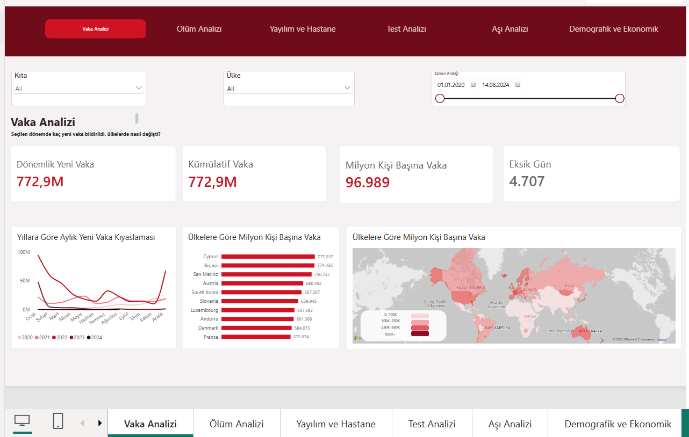
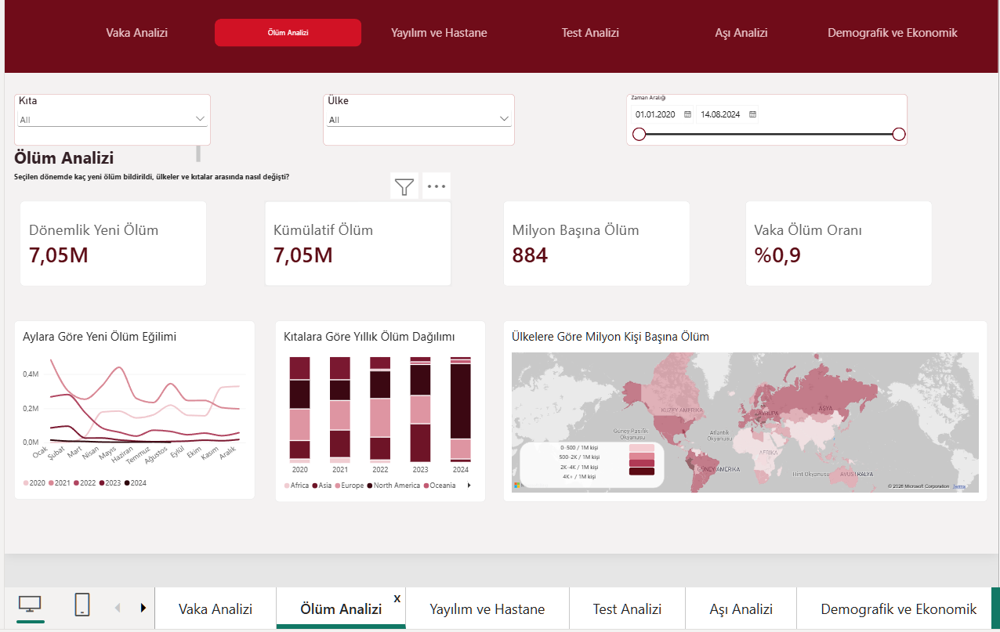
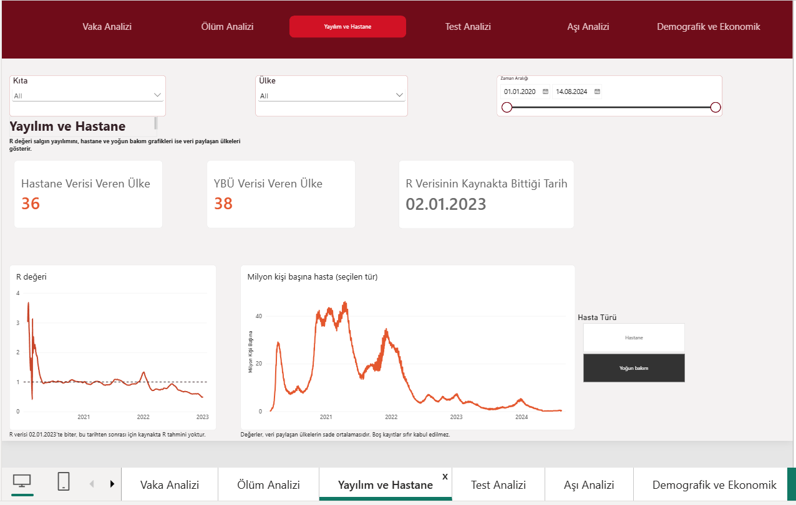
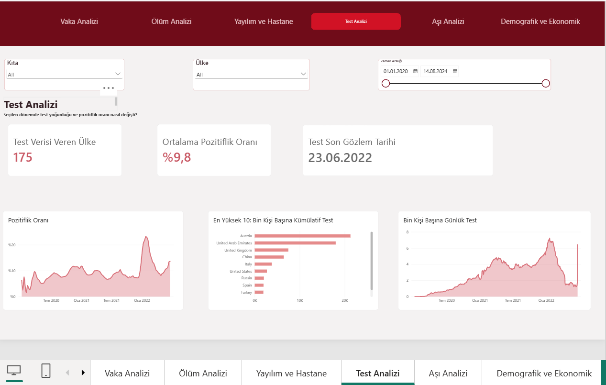
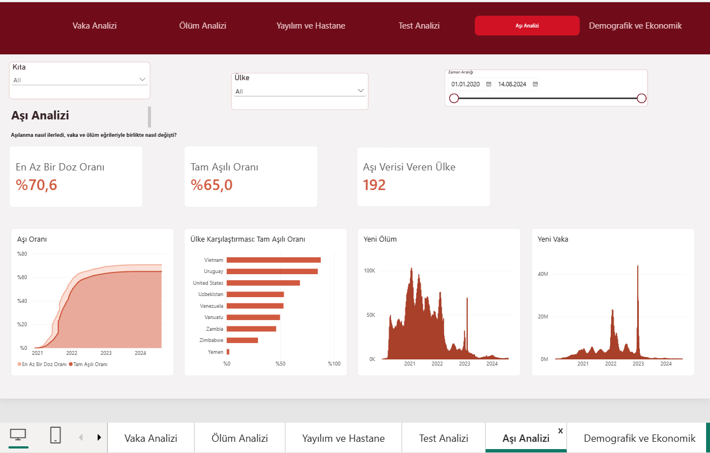
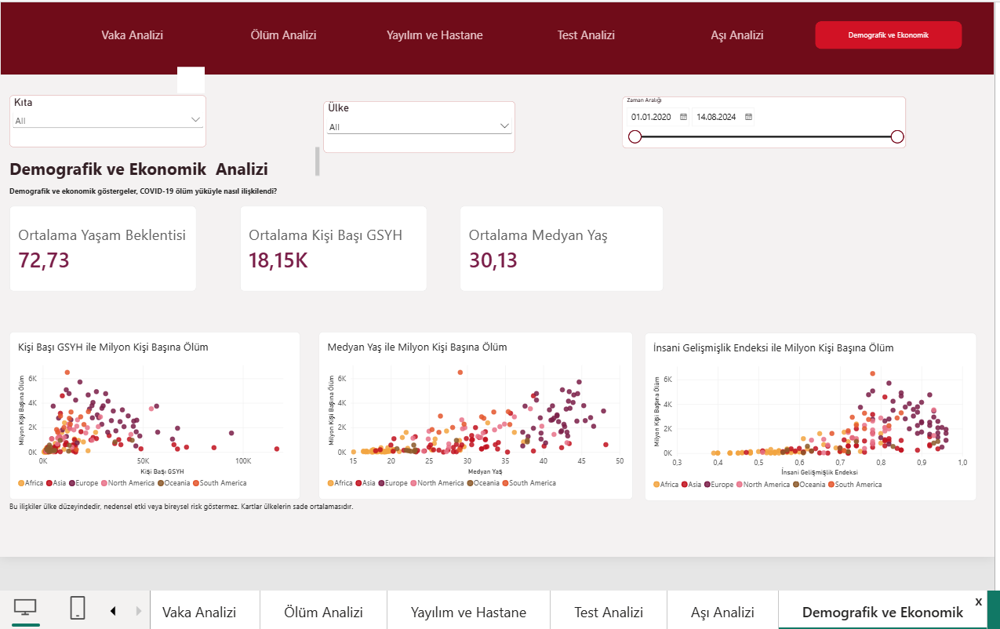

# COVID-19 Analysis Dashboard


> **End-to-end COVID-19 data analysis project prepared with Python, PostgreSQL and Power BI.**
>
> It cleans, analyzes and presents countries' COVID-19 case, death, hospital, testing, vaccination and demographic indicators in an interactive Power BI dashboard.



## Demo

A 65-second walkthrough of the Power BI dashboard:

[Watch the demo video](dashboard/demo/covid19_dashboard_demo.mp4)

The dashboard is in `dashboard/covid19_dashboard.pbix` and opens with Power BI Desktop. Screenshots of all 6 pages are in `dashboard/screenshots/`. The dashboard interface and chart titles are in Turkish.

---

## Purpose of the Project

COVID-19 data is reported at different frequencies, to different extents, and sometimes underreported across countries. This project was prepared to make country comparisons more meaningful by taking into account data quality and measurement definition rather than basing them directly on total numbers.

This project analyzes case, death, testing, vaccination, hospital, and demographic indicators in one workflow. It presents total figures alongside population-adjusted values and shows the data limits that should be considered when interpreting the results.

---

## Project Summary

This project examines COVID-19 data at the country level at two scales:

| Scale | What does it say? |
|---|---|
| **Absolute values** | Total cases, total deaths and new records in a certain period |
| **Values by population** | Cases, deaths, hospital and intensive care burden per million population |

This distinction is important. Countries with large populations may stand out in total numbers; Country rankings may vary when using values per million people. Continent, Country, and Date filters in the Dashboard narrow this comparison across all pages.

---

## Highlighted Findings

| Topic | Brief finding | Detail |
|---|---|---|
| Cases | The United States, China, and India lead in total cases; population adjustment changes the ranking. | [Case analysis](notebooks/cases_analysis.ipynb) |
| Deaths | Large-population countries lead in total deaths; deaths per million highlight different countries. | [Death analysis](notebooks/deaths_analysis.ipynb) |
| Spread | R > 1 indicates increasing spread. The R series ends in the source on 02.01.2023. | [Spread and hospital analysis](notebooks/spread_hospital_analysis.ipynb) |
| Testing | Different test units are not the same measure. Cross-country rankings use only tests performed. | [Testing analysis](notebooks/testing_analysis.ipynb) |
| Vaccination | Missing vaccination records are not treated as zero; vaccination rates in Türkiye rose during 2021 and later levelled off. | [Vaccination analysis](notebooks/vaccination_analysis.ipynb) |
| Demographics | The share of the population aged 65+ has a positive relationship with deaths per million; this does not show causality. | [Demographic analysis](notebooks/demographic_economic_analysis.ipynb) |

---

## Notebook Guide

| File | Purpose | Key point |
|---|---|---|
| [data_audit_cleaning.ipynb](notebooks/data_audit_cleaning.ipynb) | Audits raw data, separates locations, and creates the cleaned country table. | Duplicate country-date records are deduplicated only when populated values do not conflict. |
| [cases_analysis.ipynb](notebooks/cases_analysis.ipynb) | Analyzes cases, weekly changes, missing days, and cases per million. | Missing days are not zero; incomplete weeks are excluded from cross-country comparisons. |
| [deaths_analysis.ipynb](notebooks/deaths_analysis.ipynb) | Analyzes death series and deaths per population. | Source corrections in cumulative deaths are retained; missing days are not filled with zero. |
| [spread_hospital_analysis.ipynb](notebooks/spread_hospital_analysis.ipynb) | Analyzes R values, policy stringency, hospital burden, and ICU burden. | Hospital and ICU data are interpreted only for countries that report them. |
| [testing_analysis.ipynb](notebooks/testing_analysis.ipynb) | Analyzes test coverage, test units, and positivity rates. | Tests performed, people tested, and samples tested are not the same measure. |
| [vaccination_analysis.ipynb](notebooks/vaccination_analysis.ipynb) | Analyzes vaccine doses and vaccination rates with case and death trends. | The latest valid vaccination value is used for each country. |
| [demographic_economic_analysis.ipynb](notebooks/demographic_economic_analysis.ipynb) | Analyzes demographic and economic indicators and COVID-19 burden. | Each point represents a country; correlation is not evidence of causality. |

---

Detailed notebook findings are in [notebooks/notebook_findings.md](notebooks/notebook_findings.md).

## Data Validation and Analysis Approach with SQL

SQL is used to validate and reanalyze the clean and weekly tables prepared with Python in PostgreSQL. All queries are in [sql/03_analysis_queries.sql](sql/03_analysis_queries.sql).

### Table Structure

- [01_create_schema.sql](sql/01_create_schema.sql) stores project tables in a separate COVID schema.
- [02_create_tables.sql](sql/02_create_tables.sql) creates daily cleaned country data and weekly case, death, test, and vaccination tables.
- In the daily countries_clean table location + date is the primary key. Thus, a second record cannot be added for the same country and date.
- Missing day, full day, full week and data status fields are preserved in weekly tables. In this way, it is seen which records are compared with confidence in the analysis.

### Check First, Compare Then

SQL queries first check the number of records, number of countries, date range, duplicate records, and data scope of each variable. This step verifies that the clean tables prepared in the notebook are imported correctly into PostgreSQL.

We used only full week data in the weekly results. If a country is missing a day of the week, that country is not included in the global total for that week. Therefore, the “highest global week” results show the **recorded total of countries reporting full data**, not all countries.

### Procedure Followed in Case and Death Inquiries

- First, the highest global weeks for cases and deaths were found.
- In the same week, the share of countries in the world total was calculated.
- Besides absolute totals, values per million people were also listed; thus reducing the population impact.
- Countries with a population of at least 1 million were used in some peak comparisons to reduce very small countries being disrupted by extreme values.
- China's unusual week of cases in December 2022 was first examined individually, then a global comparison was made excluding China.
- Sudden death spikes in Chile and Ecuador were checked with daily records.
- To reduce the impact of single-week aggregate notifications, the 4-week moving average death burden of countries was also calculated.

### Test Data Decision

In test data, the number of tests performed, the number of people tested, and the number of samples are not the same measure. Therefore, raw test totals were not directly compared across all countries. Only countries using the **number of tests performed** unit were selected in common testing rankings.

The "cases per 100 tests" result, found by directly dividing the test by the case, could exceed 100 in some countries. This measure was not considered reliable because testing and case reports did not represent the same person or the same reporting time. Instead, the positivity rate from the source, daily test density and the number of recorded days were evaluated together.

### Vaccine Comparison Decision

Since vaccination rates are not published every day in every country, the country's last valid vaccination observation was used each week. Off days were not interpreted as zero vaccination.

Countries were divided into low, medium and high groups according to the full vaccination rate in the week of September 6, 2021, when common data coverage was high. Death rates per million people over the next 12 weeks were compared. The medium coverage group is higher than the low coverage group; It shows that other factors, such as age structure, time of wave, health system, and underreporting, influence the outcome. This analysis is not evidence of causality.


---

## Dashboard Images

### Case Analysis


This page shows case trends for the selected period.

- **Period New Cases (Dönemlik Yeni Vaka):** The total number of new cases reported during the selected period.
- **Cumulative Cases:** The latest reported total number of cases for each country.
- **Cases per Million (Milyon Kişi Başına Vaka):** Total cases adjusted for each country's population.
- **Missing Days:** The number of days with no new case data. It does not mean zero cases.

The monthly line chart compares epidemic waves, the bar chart compares countries by population, and the map shows the distribution of the burden among countries.

### Death Analysis



This page shows the death burden for the selected period alongside case data.

- **Period New Deaths (Dönemlik Yeni Ölüm):** The total number of new deaths reported during the selected period.
- **Cumulative Deaths (Kümülatif Ölüm):** The latest reported total death value for each country.
- **Deaths per Million (Milyon Başına Ölüm):** Death burden adjusted for population.
- **Case Fatality Rate:** The ratio of cumulative deaths to cumulative cases.

The line chart shows monthly deaths by year, the column chart shows the distribution in continents, and the map shows the burden of death by population.

### Spread and Hospital



This page shows disease spread alongside pressure on the healthcare system.

- **R Value:** It shows how many people a patient infects on average. If R is above 1, the spread tends to increase.
- **Country Providing Hospital / ICU Data:** It is the number of countries that share at least one record in these fields.
- **Date When R Data Ends at the Source:** This is the day when the R value was last found.

The patient type to be displayed is selected from the Hospital/ICU selection box. The chart shows the daily average per million people for countries that share data.

### Test Analysis



This page examines testing intensity and positivity rate.

- **Country Providing Test Data:** The number of countries with at least one total test record.
- **Average Positivity Rate:** Average of positivity rates in countries sharing data.
- **Test Last Observation Date:** The date the test data was last found in the source.

The bar chart shows the top 10 countries in cumulative testing per thousand people. Only countries that report data in the same unit, i.e. the number of tests performed, are included in the testing comparison.

### Vaccination Analysis



This page shows vaccination progress alongside new case and death trends.

- **At least One Dose Rate:** The rate of those who have at least one dose of vaccine according to the population.
- **Fully Vaccinated Rate:** The rate of fully vaccinated people according to the population.
- **Country Providing Vaccination Data:** The number of countries that share at least one vaccination record.
- **New Case / New Death:** Total number of new cases and deaths on the selected dates.

The last known value of each country up to that date is used in the vaccination rate. This way, the rate won't drop artificially because of countries not sharing data on that day.

### Demographic and Economic Analysis



This page shows the relationship between countries' demographic and economic indicators and the burden of death per million people.

- **Average Life Expectancy, GDP Per Capita and Median Age:** Average values of selected countries.
- Each dot represents a country and the colors represent continents.
- In the graphs, GDP, median age, human development index and death burden are examined together.

Whether these points are close or far apart tells about the relationship; It does not prove that an indicator alone causes deaths.

---

## Data Source

Data comes from the [Our World in Data COVID-19 dataset](https://ourworldindata.org/coronavirus). Our World in Data data and visualizations are available under CC BY with attribution; third-party source fields may have separate licenses.

## Project Flow

```text
Raw data → data audit and cleaning → weekly / analysis tables
        → PostgreSQL queries → Power BI dashboard
```

## Technologies

- **Python:** data review, cleaning and analysis notebooks
- **PostgreSQL / SQL:** schema, table definitions and analysis queries
- **Power BI:** interactive report, DAX measures and filters

## Folder Structure

```text
CoronaVirusProject/
??? README.md
??? .gitignore
??? pyproject.toml
??? src/ # data_loader.py
??? notebooks/ # inspection, cleaning and analysis notebooks
??? sql/ # schema and analysis queries
??? dashboard/ # .pbix, theme and screenshots
?   ??? demo/ # dashboard walkthrough video
??? docs/ # metrics, validations and methodology notes
??? data/ # data setup instructions only; raw data is not versioned
??? outputs/ # locally produced charts and images
```

## Installation and Operation

1. Clone the repository and create the Python environment.
2. Install the dependencies via `pyproject.toml`.
3. Download the source data locally under `data/raw/`.
4. First run notebook `notebooks/data_audit_cleaning.ipynb`.
5. Run other notebooks in analysis order.
6. Open the `dashboard/covid19_dashboard.pbix` file in Power BI; Update the data source path to your local `data/processed/` folder.

For data placement details, see [data/README.md](data/README.md).

## Important Calculation Decisions

- Taiwan, Kosovo, Hong Kong and Palestine are treated as separate country units in the analysis. All locations listed with country status in the data source are considered country units.
- Missing observations are not considered zero; remains blank on cards and charts.
- In weekly analysis, the full week rule is applied.
- Cumulative values are calculated by taking the last valid value for countries; daily lines are not collected.
- Rates and per capita values are not directly aggregated across countries; A conservatively weighted or country average approach is used.
- Demographic charts are at country level; relationships are not evidence of causation.

## Limitations

- R value source ends on 02.01.2023.
- Hospital and ICU indicators cover only a few dozen countries that share data.
- There may be reporting differences, missing days and retrospective corrections in test and vaccine series.
- In cross-country comparisons, data quality and reporting scope may affect the results.

## License

This project is licensed under the [MIT License](LICENSE).
