## Notebook Findings

### Data Audit and Cleansing

- Locations in the data set; The main analysis was divided into countries, regions/locations with special status, continents, income groups, and World and European Union totals.
- Locations that should not be considered countries, such as Western Sahara, Faroe Islands and United Kingdom sub-regions, were kept in `df_regions`.
- Duplicate records according to `location` and `date` columns were checked in all data groups.
- Duplicate dated records were found in East Timor, Faroe Islands, income groups and European Union totals.
- Checked whether duplicate records contain contradictory filled values in the same date and column.
- Since there were no conflicting values, duplicate records were deduplicated by preserving the non-empty value in each column.
- `location + date` repetition remaining in all data groups after deduplication was checked.
- The first and last registration date of each location, the number of registered days and the number of missing days in this range were calculated.
- A one-day record deficiency was detected for Northern Cyprus on December 5, 2022.
- The missing date was not interpreted as zero cases or zero deaths; data quality grade was maintained.
- The cleaned data files were saved.

This data audit examined only structural issues. Missing values on a column basis will be evaluated separately according to the meaning of the variable in the relevant analysis notebooks.

### Case and Death Burden: Absolute Value and Measurement Based on Population are Different
#### Detailed Findings of the Case Notebook

Case Analysis Procedures and Findings
- Cleaned country data was used. The review found that the data set contained 324,819 rows and 67 columns belonging to 194 countries. Dates range from January 1, 2020–August 14, 2024.
- Country–date duplications have been checked. No duplicate country-date records were found in the cleaned country table.
- Missing records in the total_cases column were examined. In countries with partially missing data, gaps were found before the first full record or after the last full record.
- Decreases in the number of cumulative cases were checked. It was found that in 16 country–date records, the total_cases value decreased compared to the previous record.
- Daily case records on the decrease dates were examined. The review found that the new_cases value was empty in all 16 records. This does not prove that null values cause reduction. Since the cause of the decreases was not confirmed, the source values were retained.
- Missing values in the new_cases column were classified. Gaps were found at the beginning, within the data series, and at the end. A one-day gap was found between filled records in 16 countries.
- Negative daily new case values were checked. No negative new_cases records were found during the check.
- Weekly new case totals were created. Daily records were divided into Monday–Sunday periods and current daily case values were collected. Completely empty weeks were kept as NaN.
- Weekly data coverage was measured. The number of registered days, full days and missing days were calculated for each week. Weeks with full seven-day case data were marked as “full weeks”.
- A display rule was set for incomplete weeks. The total for available days is shown with a note that the week is incomplete. Weeks with no recorded values were labeled "No data."
- Weekly change was calculated. Increases and decreases were calculated only between two consecutive full weeks. Percentage change was not calculated when the previous week's total was zero.
- Population data was checked. No missing, zero or negative population values were found. No different population values were found within the same country.
- Weekly new cases per million people were calculated. To account for country population differences, the weekly case total was divided by the population and multiplied by one million. This indicator in the last chart was kept for full weeks only.
- Türkiye's weekly and cumulative case trends were examined. The fact that new cases have been mostly zero recently was found to be compatible with the horizontal progress of the cumulative total at approximately 17 million. This does not indicate that the actual occurrence of cases has completely stopped.
- Countries were compared as of August 4, 2024. USA, China and India in total cases; Brunei, San Marino and Austria were in the top three places in total cases per million people. Calculation by population changed the country ranking.
- Reviewed data coverage for the common week. During the week of May 8–14, 2023, all 194 countries had a full seven-day record of new cases. A comparison of new cases per million people has been prepared for this week. The presence of complete records does not alone prove that reporting is current.
- Cumulative case values over the weekend have been added. The total_cases value of each country on Sunday was taken. Cumulative values were not collected weekly; It was left missing when the Sunday value was unavailable.
- A weekly output table was prepared for the dashboard. Current case total, data coverage, weekly changes, case value by population and weekend cumulative total were combined in the same table.

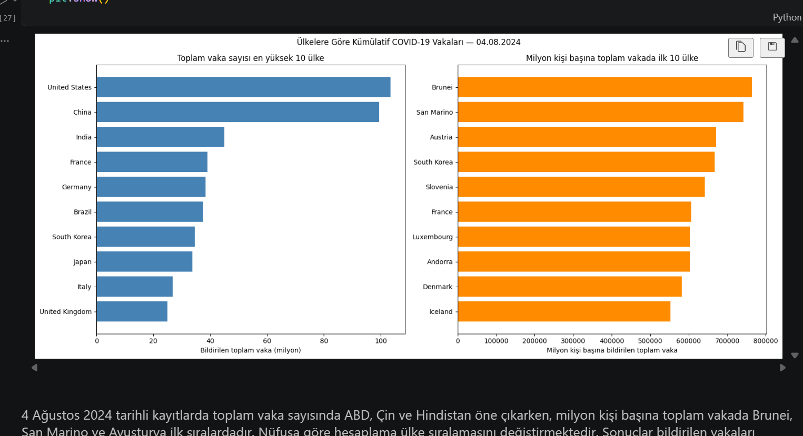
#### Case Curves in Türkiye

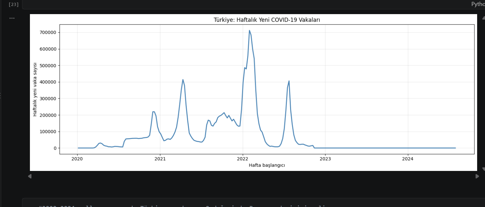

The weekly number of new cases in Türkiye reached its highest level at the beginning of 2022. If the series approaches zero after 2023, this indicates the end of regular case reporting in this period; It does not mean zero cases.

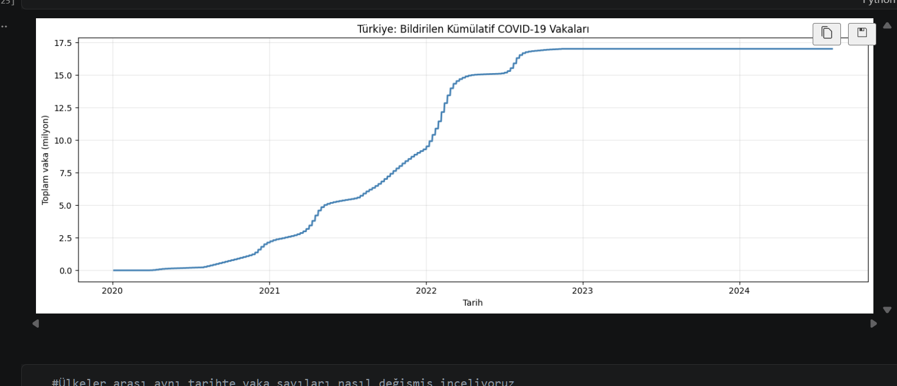

The cumulative incidence curve only moves upward. Periods when the curve steepens are waves in which new case notifications accelerate.

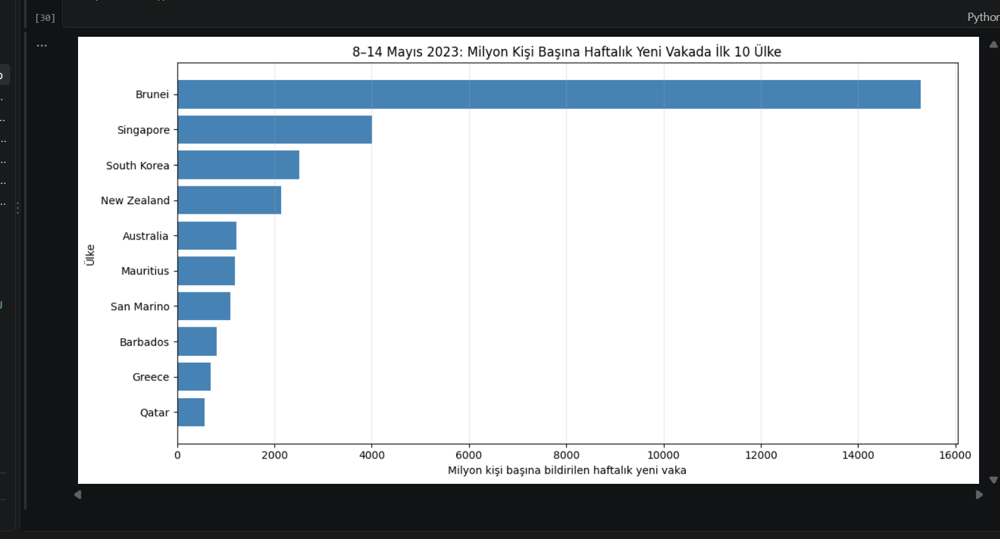

In the week of 8–14 May 2023, countries with small populations, especially Brunei, are at the top in weekly cases per million people. This visual shows that the total count and the measure by population produce different rankings.

> **How did we calculate?** We summed the daily case numbers into weeks. If a week was missing a day, we did not use that week when comparing countries.

The United States, China, and India are highlighted in the total number of cases reported as of August 4, 2024. Calculating per million people reduces the effect of population size and may change the ranking. For this reason, absolute values and per capita measurements are presented together on the dashboard.

#### Detailed Findings of the Death Notebook

- Cleaned country data was used. Only countries were included in the analysis; Country-date duplications are not present in the cleaned data file.

- The data scope of the `total_deaths` column has been examined. Gaps in partially incomplete cumulative death records were found at the beginning or end of the data stream. No missing `total_deaths` records were detected among the full death records.

- Decreases in the cumulative number of deaths were checked. The review found that the `total_deaths` value in 9 country-date records decreased compared to the previous record.

- The `new_deaths` value was missing on all 9 dates when cumulative deaths decreased. This association does not prove that incomplete daily death registration is the cause of the decline. Source values were retained because it was not verified whether the reductions were source corrections or data issues.

- Missing records in the `new_deaths` column were classified as first, middle and last. A one-day missing death record was found among full records for Australia, Canada, Chile, China, Indonesia, Panama, Papua New Guinea, Sierra Leone and Thailand.

- No negative `new_deaths` records found.

- Daily new death records were grouped weekly according to the periods Monday–Sunday. The current death total, number of full days, and number of missing days were calculated for each country and week.

- Complete weeks, weeks with missing days, and weeks with no data are labeled with the `data_status` column. In missing weeks, only the total of available days was preserved; This value was not interpreted as the total for the full week.

- Weekly mortality difference and percentage change were calculated for two consecutive full weeks only. The percentage change was left blank when the previous week's death total was zero.

- Weekly death values were calculated per million people. The current day total for incomplete weeks and the reliable comparison value for complete weeks only were kept in separate columns.

- The `total_deaths` value on Sunday of each week has been added as cumulative deaths over the weekend. Cumulative mortality values were not collected weekly.

- Weekly reported death and cumulative death curves for Türkiye were examined. Missing weeks were prepared so that they could be marked separately on the chart.

- USA, Brazil and India in total number of reported deaths on August 4, 2024; Peru, Bulgaria and North Macedonia ranked first in total deaths per million people. Calculation by population changes the country ranking.

- Reviewed data coverage for the common week. Seven-day death data was found for all 194 countries for the week of June 19–25, 2023. A comparison of weekly deaths per million people has been prepared for this week.

- `weekly_deaths.csv` table was created for Dashboard. This table includes current death total, data status, weekly change, values per million people, and weekend cumulative deaths.

- Excess mortality data was not included in the analysis of this project because it was not included in the dashboard plan.

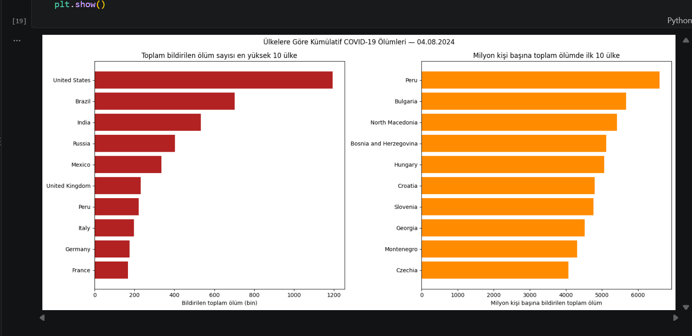
#### Death Curves in Türkiye

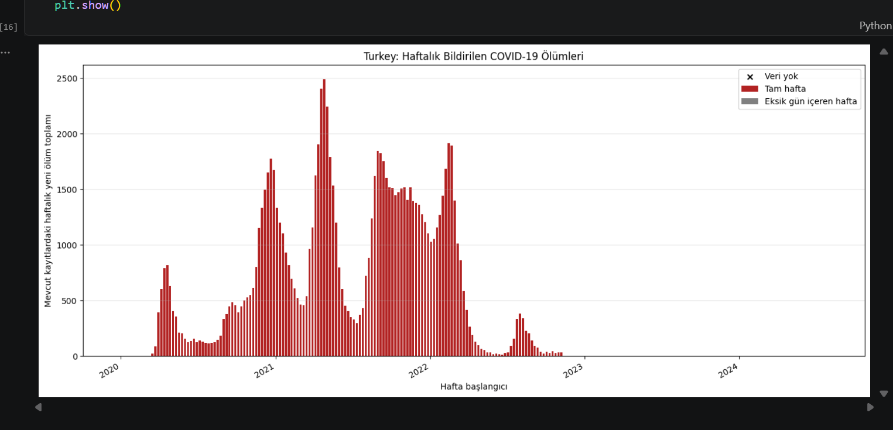

The weekly new death chart in Türkiye separates weeks with full weeks and weeks with missing days. The highest waves of deaths occur in 2021 and early 2022.

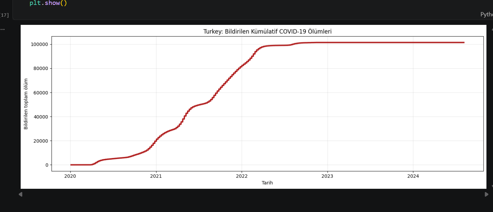

Rapid rises in the cumulative mortality curve are associated with epidemic waves. The recent flattening indicates a decrease in the increase in the number of reported deaths.

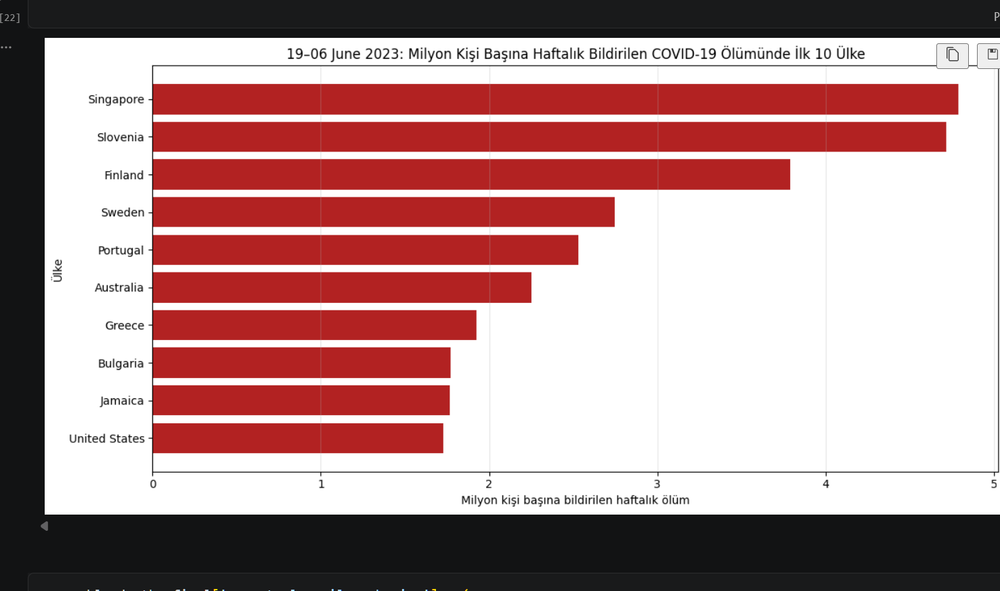

A ranking of new deaths per million people for the week of June 19–25, 2023 highlights different countries from the total number of deaths. Therefore, it is necessary to examine the burden of death according to population.

> **How did we calculate?** We did not show the missing days as zero deaths. We calculated weekly change only between two weeks with complete data.

The same distinction is seen in mortality data. While countries with large populations stand out in the absolute number of reported deaths, the ranking of deaths per million people puts countries as diverse as Peru, Bulgaria and North Macedonia ahead. These images show reported results. They do not measure the success of outbreak management due to differences in data coverage and reporting.

### Spread and Hospital Burden
#### Detailed Findings from the Spread and Hospital Notebook

#### R Value and Precautionary Stringency

- `reproduction_rate` shows the rate of spread of the epidemic. `R > 1` indicates that the spread tends to increase, and `R < 1` indicates that the spread tends to slow down.
- R value has been found in 191 countries. The days in between are complete within the active recording range of each country's R data.
- Since R data is mostly not available in the source after January 2, 2023, R charts do not cover this date.
- Since the R value of 191 countries was found together on January 2, 2023, the R comparison between countries was made on this date.
- `stringency_index` shows the stringency of governments' measures such as school/workplace closures, travel restrictions and similar measures, in the range of 0–100.
- In the example of Italy, R value and precautionary stringency were examined together between 24 February 2020 and 31 December 2022.
- Although higher precautionary stringency and lower R value are observed together in some periods, this does not prove causality. Vaccination, variants, testing capacity, behavioral changes and the delayed impact of measures also affect the spread of the epidemic.

#### Hospital and Intensive Care Burden

- `hosp_patients` and `icu_patients` show the number of COVID-19 patients in hospital and intensive care on a specific date.
- Hospital patient data was found in 36 countries, intensive care patient data was found in 38 countries. The number of countries sharing both indicators together is 32.
- In some countries, there are empty days in the active date range of hospital or intensive care data. These spaces are not filled with zeros.
- 16 countries with uninterrupted hospital and intensive care data during the active period were identified. These countries should be preferred for long-term time charts.
- Italy; It was used for the sample time chart because the hospital and intensive care data are uninterrupted within the same date range, 24 February 2020–7 August 2024.
- In comparison between countries, `hosp_patients_per_million` and `icu_patients_per_million` were used instead of the raw number of patients. Thus, population size was prevented from misleading the comparison.
- Values per million people are consistent with calculations based on the raw number of patients and the population.
- On February 13, 2022, both hospital and intensive care data of 30 countries were found together. On this date, Bulgaria was among the countries with the highest hospital and intensive care patient load per million population.
- The high hospital load in Bulgaria coincides with the high case and death load in late January and February 2022. However, this cannot be explained by the health system capacity or a single factor alone.

#### Weekly Hospitalization and Bed Capacity Indicators

- `weekly_hosp_admissions` and `weekly_icu_admissions` are weekly hospital and intensive care admission indicators reported by the source.
- These indicators are only available in a limited number of countries and are shared between countries with different recording frequencies, daily or weekly.
- For this reason, weekly hospitalization indicators were not re-collected and were not used in comparisons between main countries. If necessary, it can be displayed as the value reported by the source in the selected country detail.
- `hospital_beds_per_thousand` is a fixed country information showing hospital bed capacity per thousand people. It will be used as a country context indicator, not as a daily time series.

#### Dashboard Decisions

- Country comparison and selected country time chart for R value can be presented; It should be noted that data coverage ends at the beginning of 2023.
- Hospital and intensive care time graphs should only be shown for countries with sufficient and uninterrupted data.
- Hospital and intensive care indicators per million population should be used in country comparisons.
- Days with no data will not be considered zero and will be preserved as spaces in the graphs.
- There is no need to create a separate processed CSV for this section; dashboard can use daily indicators from `countries_clean.csv` file.

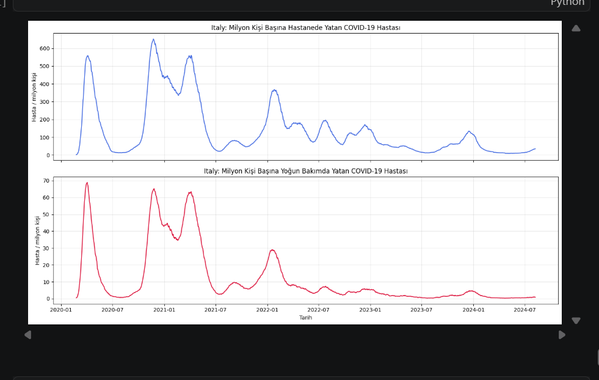
#### Additional Images for Spread and Hospital

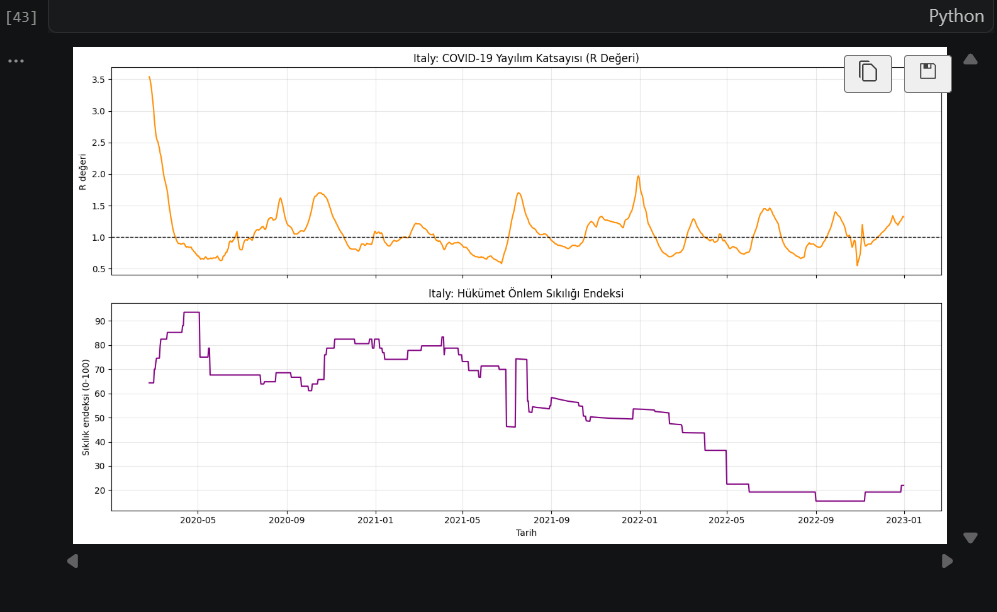

In the Italian example, the R value and the stringency of measures are seen on the same time axis. An R value above the 1 line indicates that the spread tends to increase; This graph alone does not prove the effectiveness of the measures.

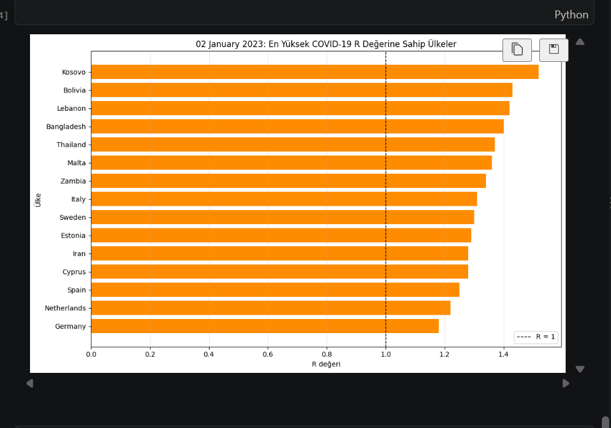

On January 2, 2023, Kosovo, Bolivia, and Lebanon are among the highest R values. The dashed line indicates the threshold R = 1.

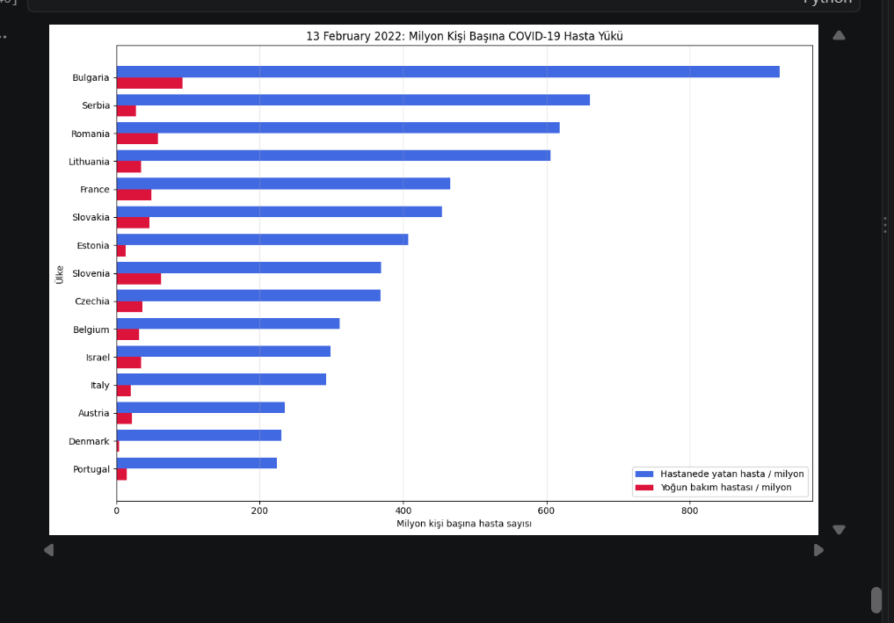

On February 13, 2022, Bulgaria, Serbia and Romania stand out in the number of hospitalized people. Since hospital and intensive care burdens are shown per million people, countries can be compared.

> **How did we calculate?** We compared the number of patients according to the population of the countries. We did not accept countries that did not provide data and empty days as zero. R value data ends on 02.01.2023.

Series of patients in hospital and intensive care show the burden on a given day. For Italy, the two load indicators fluctuate together; The intensive care curve moves in lower but similar epidemic waves. This data is only available for countries that share hospital data; Missing days are not considered zero.

### Interpretation of Test Data
#### Detailed Findings of Test Notebook

#### Data Scope and Test Units

- `total_tests` is available in 172 countries, `new_tests` is available in 142 countries, `new_tests_smoothed` is available in 169 countries and `positive_rate` is available in 162 countries.
- Test unit information is available in 176 countries.
- 138 countries use `tests performed`, 23 countries use `people tested`, 14 countries use `samples tested` and 1 country uses `units unclear` test unit.
- No country has seen more than one testing unit over time. Therefore, the test measurement unit is consistent in each country's own time series.
- Raw `total_tests` and `new_tests` values should not be directly compared between all countries as different test units do not represent the same measurement.

#### Total and Daily Test Data

- There was no decrease in the number of cumulative tests in `total_tests`. Cumulative totals logically increase in periods where test data is available.
- Most of the `total_tests` and `new_tests` gaps are found in the beginning or ending period of the data series. Gaps in the active reporting period are limited.
- No negative values were found in the `new_tests` field.
- In 122 of the 142 countries with `new_tests` data, records were shared mostly at daily intervals.
- There are also countries that report less frequently or have only a small number of testing records. Therefore, weekly test totals are calculated only for weeks with `new_tests` data on all 7 days.
- Weeks with missing days are not filled with zeros, but are labeled with `full_week` and `data_status` fields.

#### Positivity Rate and Test/Case Ratio

- All `positive_rate` values are in the range 0–1; No values were found outside the logical limit.
- Most positivity rate gaps are in the beginning or ending period of reporting. It is suitable for selected country time charts as the gaps within the active period are limited.
- There are no zero or negative values in the `tests_per_case` field.
- In the selected country example, the positivity rate increased while the testing intensity decreased in some periods. This may be related to the application of tests to more risky people, testing capacity or increased transmission; The chart alone does not show causation.

#### Cross-Country Comparison and Dashboard

- The positivity rate is a more appropriate indicator of comparison between countries than the raw number of tests.
- The date with the highest common positivity rate is March 20, 2022; On this date, 136 countries have a positivity rate.
- Only 107 countries using `tests performed` are used in the comparison chart.
- In the selected country time chart, the corrected testing intensity and positivity rate per million people are shown in separate panels.
- `weekly_tests.csv` table has been created for Dashboard. The weekly test card should only be used on records where `full_week=True`.
- The test unit, data status and last observation date should be displayed to the user on the dashboard.

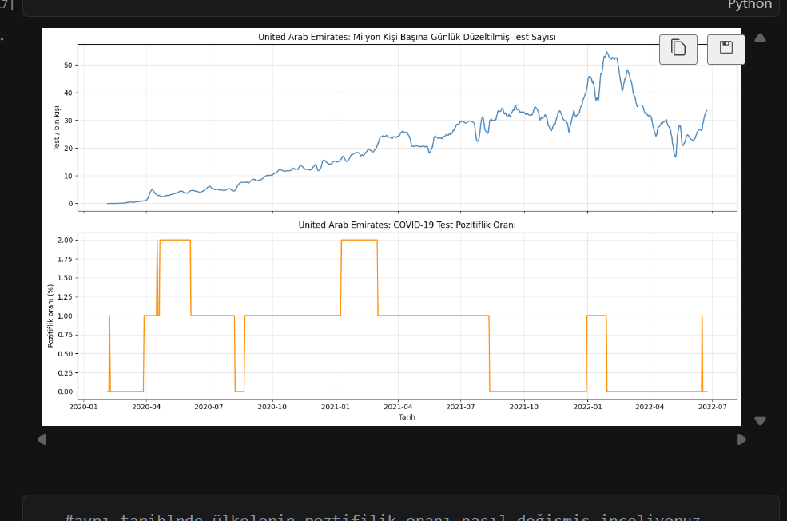
#### Positivity Rate Comparison

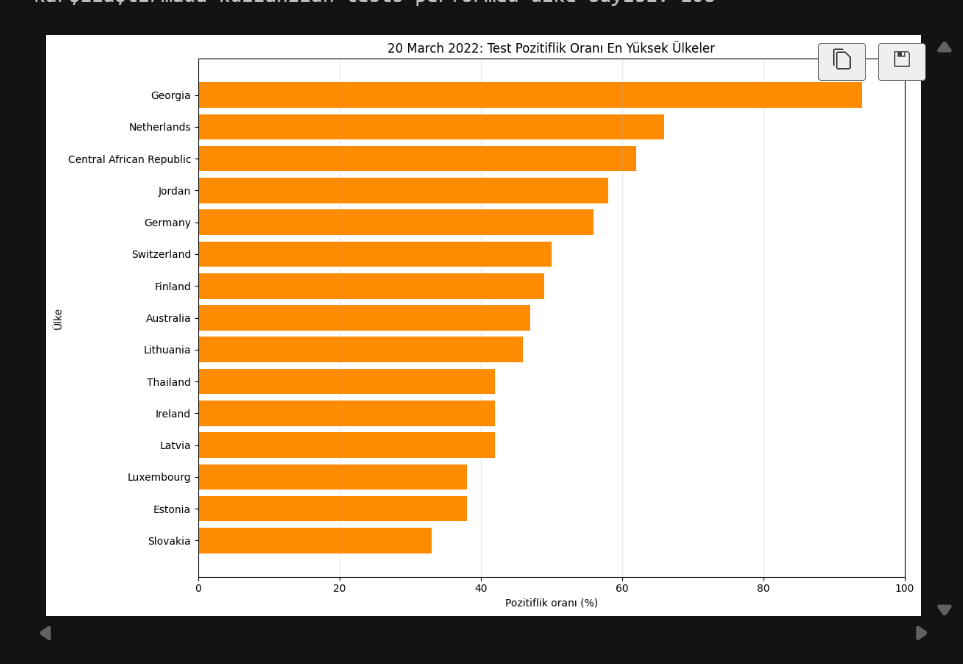

On March 20, 2022, the highest positivity rates are seen in Georgia and the Netherlands. The positivity rate should be interpreted in conjunction with testing intensity and reporting scope.

> **How did we calculate?** To compare countries fairly, we only used countries that reported the number of tests performed. We did not fill in the missing days.

Test intensity and positivity rate are not reported with the same frequency in every country. This example makes visible changes in the test series and interruptions in positivity reporting. In cross-country test comparisons, only countries using the `tests performed` unit are evaluated; Data reporting as number of individuals or samples do not represent the same scale.

### Vaccination, Case and Mortality Curves
#### Detailed Findings of the Vaccine Notebook

- Cleaned country data was used. Vaccine analysis is based on country-by-country records in `countries_clean.csv`.

- Country-based data coverage of total dose, person with at least one dose, fully vaccinated person, booster and vaccination rate columns was examined.

- It has been observed that full vaccination rate data is not published daily and uninterruptedly in many countries. Missing records can be found at the beginning, between and at the end of the data flow.

- Missing vaccination rates were not filled with zeros. A blank record was not interpreted as no vaccinations taking place that day.

- No negative total dose, first dose person, fully vaccinated person or booster records were found.

- No logically contradictory records were found in which the number of fully vaccinated people exceeded the number of people who received at least one dose.

- No decrease over time was detected in the `total_vaccinations`, `people_vaccinated`, `people_fully_vaccinated` and `total_boosters` columns.

- Instead of the daily regular registration requirement, a weekly vaccination observation table was created for each country.

- The last record containing both the first dose and the full vaccination rate in each week was selected as 'observation_date'. The delay of this observation compared to the weekend was kept in the `observation_delay_day` column.

- If two vaccination rates were not found together in a week, the rates were left blank and marked as "No vaccination rate data" in the 'data_status' field.

- First dose and full vaccination rates in the common week were compared between countries. Only countries with both rates were used in the comparison.

- Vaccination rate, weekly new cases and weekly new death curves for Türkiye were shown on the same time axis. These graphs show the change over time; does not prove a causal effect on its own.

- `weekly_vaccinations.csv` table was created for Dashboard. Table; includes weekly vaccination rates, actual observation date, observation delay, and data status.

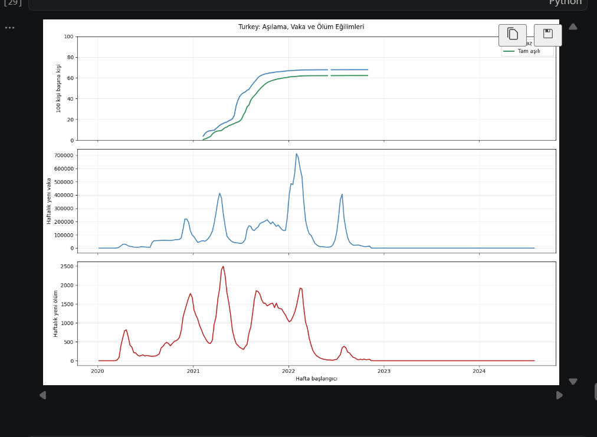
#### Vaccine Scope and Progress

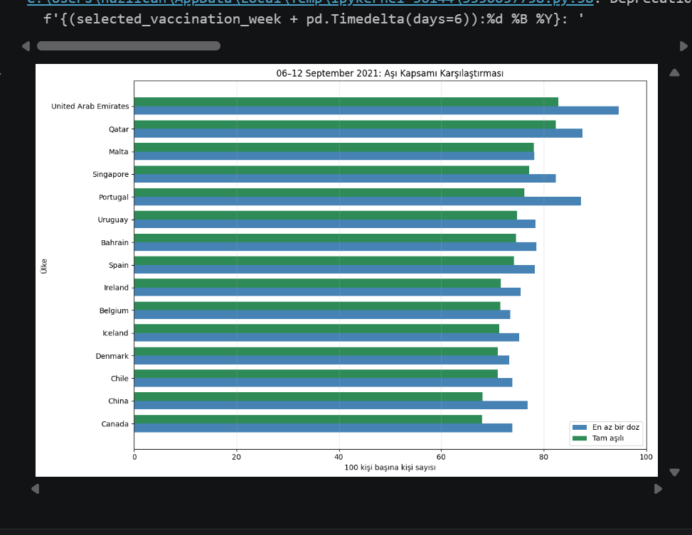

For the week of September 6–12, 2021, the United Arab Emirates and Qatar are at the top of the list in terms of fully vaccinated rates with at least one dose. Blue bar indicates at least one dose, green bar indicates fully vaccinated rate.

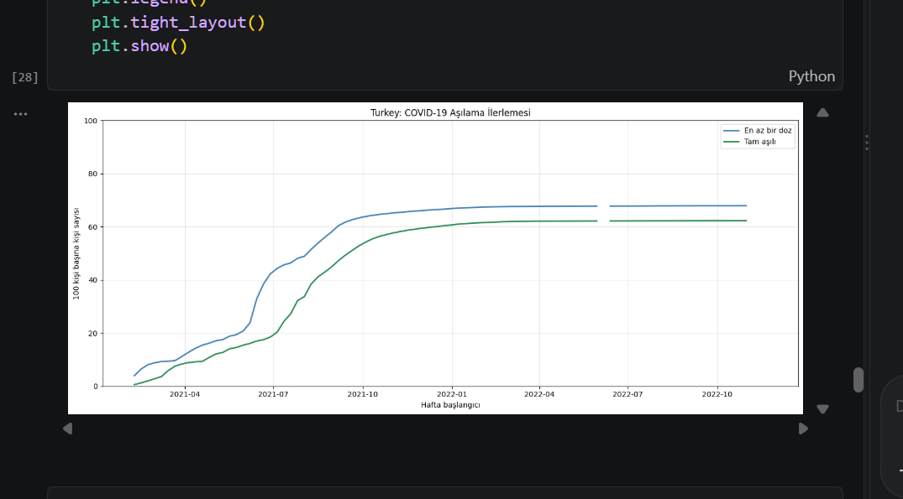

The rate of at least one dose and fully vaccinated in Türkiye increases throughout 2021 and then flattens out. Gaps in the series are missing data; It does not mean zero vaccination.

> **How did we calculate?** We got the countries' most up-to-date vaccination rate for each week. If data was not available, we left that week blank; We did not present it as if zero vaccination was done.

The rate of at least one dose and full vaccination in Türkiye increased throughout 2021 and then plateaued. Display on the same time axis as the case and death curves describes how the periods change together. This image is not evidence of a causal vaccine effect. Factors such as variants, level of testing, age structure and reporting also play a role.

### Demographic and Economic Relations
#### Detailed Findings of the Demographic and Economic Notebook

#### Data Quality and Country Profile

- Demographic, economic, health risk and infrastructure indicators were examined as fixed information on a country basis.
- There are no more than one different value in fixed indicators over time and no abnormal records outside the defined logical limits.
- A single-row `country_profile` table has been created for each country.
- If a country was missing an indicator, the country was excluded from the analysis where only that indicator was used. The country is not completely excluded from the analysis unless all indicators are missing.

#### Mortality and Vaccination Comparisons

- The largest common coverage for total COVID-19 deaths per million people was found in 194 countries on August 4, 2024.
- The widest common coverage for the full vaccination rate was found in 106 countries on August 16, 2021.
- Different dates were used for mortality and vaccination indicators; Each indicator was evaluated on its broadest country coverage date.

#### Main Relationships

- A moderate positive relationship was seen between logarithmic GDP per capita and total COVID-19 deaths per million people (`r = 0.498`, 186 countries).
- A strong positive relationship was observed between the proportion of the population over 65 years of age and total COVID-19 deaths per million people (`r = 0.683`, 182 countries).
- A strong positive relationship was observed between HDI and complete vaccination rate (`r = 0.741`, 105 countries).
- Full vaccination rates are generally higher in countries with high HDI levels. This relationship; It may reflect co-varying factors such as health infrastructure, income, logistics capacity and vaccine access.

#### Auxiliary Indicators

- Median age and the proportion of the population over 70 years of age also showed a strong positive association with total deaths per million people.
- Female smoking rate, hand washing facilities and life expectancy have shown a positive relationship with the mortality indicator in some countries. These results should not be interpreted as a direct causal effect.
- A negative relationship was observed between the extreme poverty rate and reported COVID-19 deaths. Differences in reporting between countries, age structure, access to healthcare and level of development may affect this relationship.
- A very weak relationship was observed between diabetes prevalence and logarithmic population density and total deaths per million people.

#### Correlation Heat Map

- In the correlation heat map, it was seen that GDP, HDI, elderly population rate and life expectancy had strong relationships with each other.
- 69 countries with all selected indicators were used in the heat map.
- Correlations show associations at the country level; individual risk should not be interpreted as causal impact or policy success.

#### Dashboard Decisions

- Three scatter plots will be used in the Dashboard for GDP–deaths, population over 65 years of age–deaths and HDI–full vaccination.
- The correlation heat map will be used to examine selected demographic and economic indicators together.
- Each dot in the graphs represents a country.
- Regression or prediction model is not included in the scope of this project.

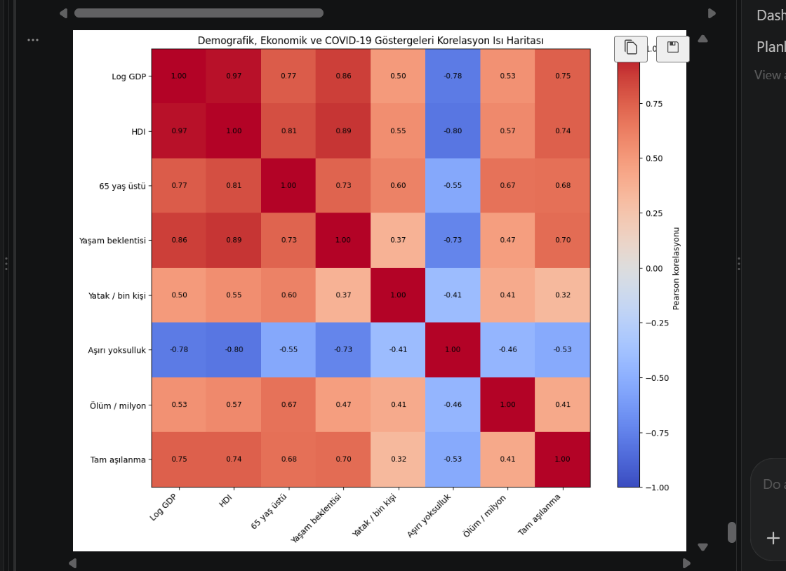
#### Demographic Scatter Plots

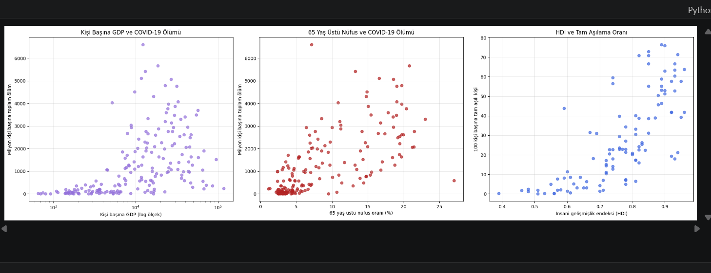

These three scatter plots show the relationship between GDP per capita, population over 65, and HDI and deaths per million people. Each point is a country. A concentration of points indicates that there are more countries with similar values.

> **How did we calculate?** We compared each country with a single profile. If any information was missing, we simply removed that country from the relevant graph. These charts show relationships, not cause and effect.

Country-level correlation analysis showed a moderate positive relationship between log GDP per capita and deaths per million people (`r = 0.498`, 186 countries). The relationship between the proportion of the population over 65 years of age and deaths per million people was stronger (`r = 0.683`, 182 countries). There was also a strong positive relationship between HDI and complete vaccination rate (`r = 0.741`, 105 countries). These relationships do not indicate causality; Co-varying social, demographic, and reporting factors may influence results.

